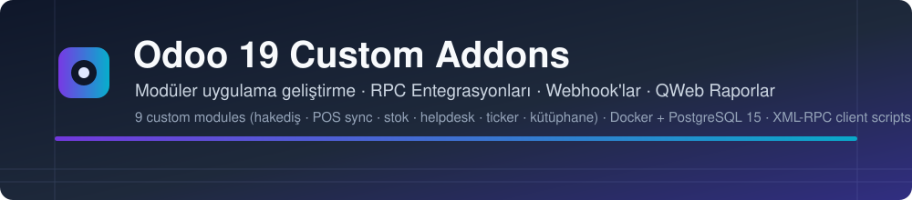
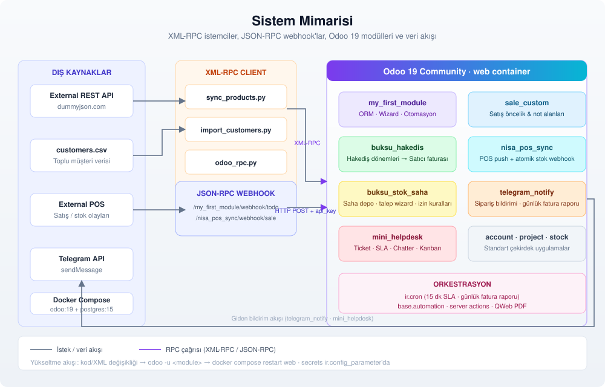
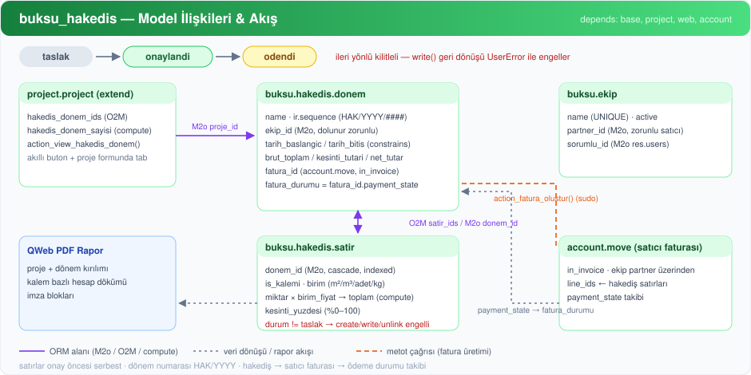
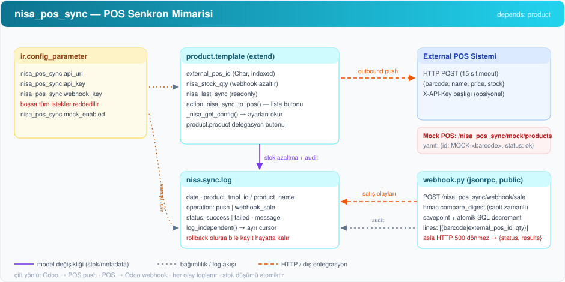
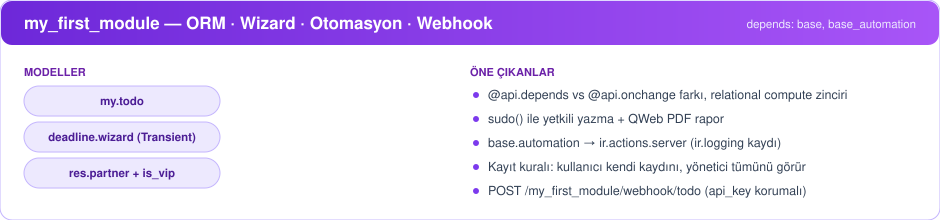
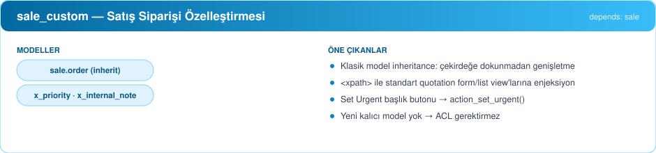
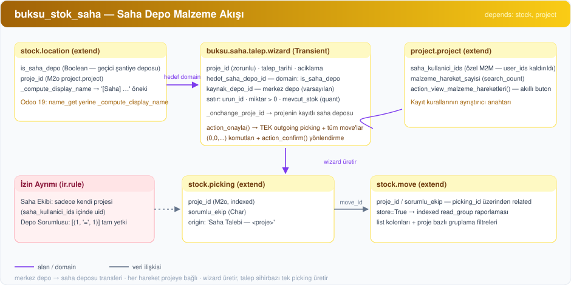
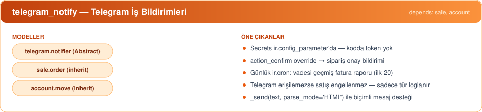
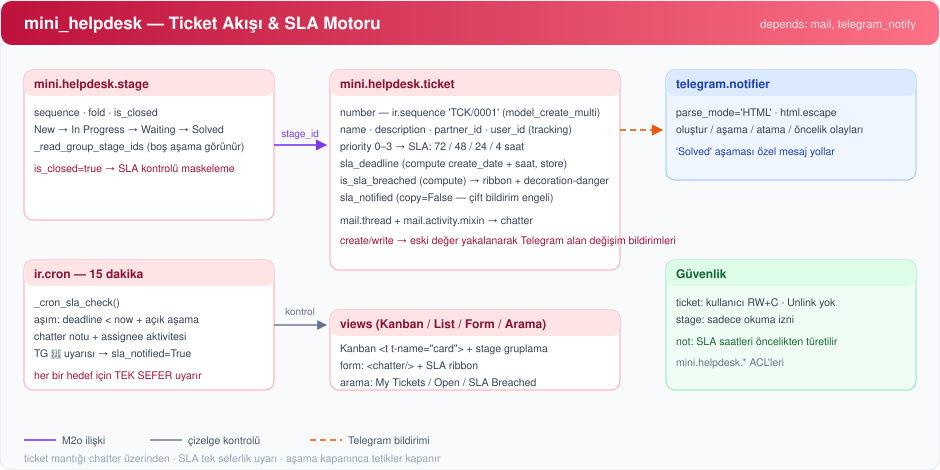
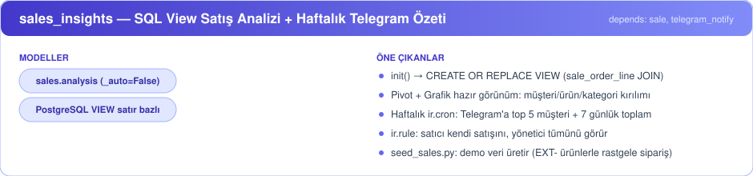

<div align="center">
  
  <p>
    
    
    
    
    
    
  </p>
  <p><em>Containerized Odoo 19 development showcase — 7 custom modules, XML-RPC clients, JSON-RPC webhooks, real-world business flows.</em></p>
</div>

# Odoo 19 Custom Addons & Architecture: Modules, ORM, Security, POS Sync, Progress Billing & RPC

A production-ready, hands-on repository showcasing modern **Odoo 19 Community** development end-to-end. It features containerized Odoo 19 + PostgreSQL, seven custom modules covering real-world business flows (construction progress billing, retail POS stock sync, field stock management, Telegram notifications, a helpdesk with SLA tracking, sales customization, and full-stack ORM patterns), external Python XML-RPC clients (CRUD, CSV import, external API product sync), and JSON-RPC webhooks.

<div align="center">
  
</div>

---

## 📦 What's Inside

| Module / Tool | Category | Core Concepts & Capabilities | Dependencies |
|---|---|---|---|
| **`my_first_module`** | Core / Productivity | Custom models (`my.todo`), `TransientModel` wizards, relational fields (`Many2one`, `related`, stored computed), `@api.depends` vs `@api.onchange`, `sudo()` elevated writes, external HTTP requests, QWeb PDF reports, multi-tier security groups, record rules, server actions, automated actions (`base.automation`), and public JSON-RPC webhook. | `base`, `web`, `contacts` |
| **`sale_custom`** | Sales | Classical model inheritance (`sale.order`), view inheritance via `<xpath>`, custom priority & internal notes, header action buttons. | `sale` |
| **`buksu_hakedis`** | Project & Accounting | Construction / traffic site subcontractor progress billing (*Hakediş*). Multi-team progress tracking (`buksu.hakedis.donem`, `buksu.hakedis.satir`, `buksu.ekip`), strict forward-only status workflow (`taslak` → `onaylandi` → `odendi`), dynamic line calculations (metraj, unit price, deductions), vendor bill creation (`account.move`), sequence auto-numbering, `project.project` smart button integration, and official QWeb PDF progress reports. | `base`, `project`, `web`, `account` |
| **`nisa_pos_sync`** | Inventory & POS | Bidirectional product and stock synchronization with external POS systems. Product template extension (`external_pos_id`, `nisa_stock_qty`), HMAC-secured atomic webhook deductions with savepoint concurrency protection, audit sync log model (`nisa.sync.log`), system parameters configuration, and built-in mock POS server for testing. | `product` |
| **`buksu_stok_saha`** | Inventory & Project | Field material & stock management for construction/traffic projects. Saha depoları (`stock.location.is_saha_depo`), project & team-linked pickings (`stock.picking.proje_id`, `sorumlu_ekip`), project-based stock move reporting (smart buttons + search filters), material request wizard (`TransientModel`) that auto-creates outgoing transfers, and record-rule security split (saha ekibi: own projects only / depo sorumlusu: all). | `stock`, `project` |
| **`telegram_notify`** | Notifications | Telegram bot notifications from Odoo. `action_confirm` override on `sale.order` (calls `super()`, then notifies), scheduled daily overdue-invoice report via `ir.cron` on `account.move`, shared private `telegram.notifier` abstract model, credentials stored in `ir.config_parameter` (never in code), failure-safe delivery (a Telegram outage never blocks a sale), and token-safe error logging. | `sale`, `account` |
| **`mini_helpdesk`** | Support / Workflow | Ticket management with `mail.thread` chatter and field tracking, kanban by stage (`group_expand` shows empty stages), sequence numbering (`TCK/0001`), priority-based SLA deadline (stored computed field, `readonly=False`), SLA breach cron (chatter message, activity, flag to prevent duplicate alerts), search filters, and rich Telegram notifications on create, stage change, assignment, priority change, and SLA breach. | `mail`, `telegram_notify` |
| **`sales_insights`** | Analytics / Reporting | SQL-view based sales analysis: `sales.analysis` model (`_auto=False`, `init()` builds a `CREATE OR REPLACE VIEW` over confirmed `sale_order_line` rows), Pivot + Graph views (customer/product/category breakdown), weekly `ir.cron` sending a top-5 customers + 7-day total Telegram summary (HTML via `telegram.notifier`), and record rules (`salesman: own sales only` / `manager: all`). `seed_sales.py` seeds 15 random demo orders over XML-RPC. | `sale`, `telegram_notify` |
| **`odoo_rpc.py`** | Integration | External XML-RPC Python client demonstrating CRUD operations, domain filters, server-side aggregation (`read_group`), One2many command tuples, and model method execution. | `xmlrpc.client`, `python-dotenv` |
| **`import_customers.py`** | ETL / Migration | Idempotent CSV import script using XML-RPC (search-before-write, upsert pattern preventing duplicate customer entries). | `csv`, `python-dotenv` |
| **`sync_products.py`** | Integration / ETL | Idempotent external API → Odoo product synchronization over XML-RPC. Matches records by `default_code` (`EXT-<id>`), creates missing products, writes only changed fields, keeps going on per-record failures, and logs a run summary to console and `sync.log`. | `requests`, `python-dotenv` |

<div align="center">
  
  
  
  
  
  
  
  
</div>

---

## 🗂️ Project Structure

```
odoo-project/
├── docker-compose.yml              # Odoo 19 + PostgreSQL 15 environment
├── requirements.txt                # Local Python dependencies for RPC scripts
├── .env.example                    # Environment template for RPC clients
├── .gitignore                      # Git ignore rules (macOS, Python, venv, .env, sync.log)
├── odoo_rpc.py                     # XML-RPC client for automated Odoo tasks
├── import_customers.py             # Idempotent CSV customer importer
├── sync_products.py                # Idempotent external API → Odoo product sync
├── customers.csv                   # Sample dataset for bulk import
├── README.md                       # Comprehensive repository documentation
├── docs/                           # README visual assets (SVG)
│   ├── banner.svg                  # Header banner
│   ├── architecture.svg            # System architecture diagram
│   └── modules/                    # One architecture diagram per module
│       ├── my_first_module.svg
│       ├── sale_custom.svg
│       ├── buksu_hakedis.svg
│       ├── nisa_pos_sync.svg
│       ├── telegram_notify.svg
│       ├── buksu_stok_saha.svg
│       ├── mini_helpdesk.svg
│       └── sales_insights.svg
└── addons/
    ├── my_first_module/            # Foundation module: ORM, wizards, actions & webhook
    │   ├── __init__.py
    │   ├── __manifest__.py
    │   ├── models/
    │   │   ├── __init__.py
    │   │   ├── todo.py             # my.todo model with computed fields & logic
    │   │   ├── res_partner.py      # res.partner VIP extension
    │   │   └── todo_wizard.py      # TransientModel bulk deadline wizard
    │   ├── controllers/
    │   │   ├── __init__.py
    │   │   └── webhook.py          # JSON-RPC public endpoint
    │   ├── views/
    │   │   ├── todo_views.xml
    │   │   ├── res_partner_views.xml
    │   │   ├── todo_wizard_views.xml
    │   │   ├── todo_report.xml     # QWeb PDF report definition
    │   │   └── automation_and_server_action.xml
    │   └── security/
    │       ├── ir.model.access.csv
    │       └── security_advanced.xml # Groups & record-level access rules
    │
    ├── sale_custom/                # Sales order extension
    │   ├── __init__.py
    │   ├── __manifest__.py
    │   ├── models/
    │   │   ├── __init__.py
    │   │   └── sale_order.py       # Custom fields & urgent button method
    │   └── views/
    │       └── sale_order_views.xml# XPath injections into standard views
    │
    ├── buksu_hakedis/              # Subcontractor Progress Billing (Hakediş)
    │   ├── __init__.py
    │   ├── __manifest__.py
    │   ├── data/
    │   │   └── sequence.xml        # Auto-sequence generator (HAK/YYYY/...)
    │   ├── models/
    │   │   ├── __init__.py
    │   │   ├── buksu_hakedis.py    # Billing periods & line calculation logic
    │   │   ├── buksu_ekip.py       # Field subcontractor teams
    │   │   └── project_project.py  # Project extension with smart stat buttons
    │   ├── views/
    │   │   ├── buksu_hakedis_views.xml
    │   │   ├── buksu_ekip_views.xml
    │   │   └── project_views.xml
    │   ├── report/
    │   │   └── buksu_hakedis_report.xml # Formal progress billing printout
    │   └── security/
    │       ├── ir.model.access.csv
    │       └── security.xml
    │
    ├── nisa_pos_sync/              # External POS & Stock Synchronization
    │   ├── __init__.py
    │   ├── __manifest__.py
    │   ├── data/
    │   │   └── ir_config_parameter.xml # API URLs and authentication keys
    │   ├── models/
    │   │   ├── __init__.py
    │   │   ├── product_template.py # POS attributes & outbound push methods
    │   │   ├── product_product.py  # Variant helper bindings
    │   │   └── nisa_sync_log.py    # Audit logging for sync events
    │   ├── controllers/
    │   │   ├── __init__.py
    │   │   ├── webhook.py          # Inbound sale webhook with atomic stock drop
    │   │   └── mock_pos.py         # Mock server for sandbox POS testing
    │   ├── views/
    │   │   ├── product_template_views.xml
    │   │   └── nisa_sync_log_views.xml
    │   └── security/
    │       └── ir.model.access.csv
    │
    ├── telegram_notify/            # Telegram notifications (orders & overdue invoices)
    │   ├── __init__.py
    │   ├── __manifest__.py
    │   ├── data/
    │   │   └── cron.xml            # Daily overdue-invoice report (ir.cron)
    │   └── models/
    │       ├── __init__.py
    │       ├── telegram_notifier.py # Private _send() helper (AbstractModel)
    │       ├── sale_order.py       # action_confirm override + notification
    │       └── account_move.py     # Overdue invoice report method for cron
    │
    ├── mini_helpdesk/              # Helpdesk tickets, stages, SLA & Telegram alerts
    │   ├── __init__.py
    │   ├── __manifest__.py
    │   ├── models/
    │   │   ├── __init__.py
    │   │   ├── stage.py            # mini.helpdesk.stage (sequence, fold, is_closed)
    │   │   └── ticket.py           # mini.helpdesk.ticket (chatter, SLA, notifications)
    │   ├── views/
    │   │   └── ticket_views.xml    # Kanban, list, form, search, action & menus
    │   ├── data/
    │   │   ├── sequence_stage.xml  # TCK/ sequence + default stages
    │   │   └── cron.xml            # SLA breach check (every 15 minutes)
    │   └── security/
    │       └── ir.model.access.csv
    │
    ├── sales_insights/              # SQL view analysis + weekly Telegram summary
    │   ├── __init__.py
    │   ├── __manifest__.py
    │   ├── models/sales_analysis.py # _auto=False model + init() view def + cron method
    │   ├── views/sales_analysis_views.xml  # Pivot + Graph + list
    │   ├── data/cron.xml            # Weekly summary (ir.cron)
    │   └── security/                # ir.rule (own sales / all) + ACL
    │
    └── buksu_stok_saha/            # Field Material & Stock Management (Saha Stok)
        ├── __init__.py
        ├── __manifest__.py
        ├── models/
        │   ├── __init__.py
        │   ├── stock_location.py   # is_saha_depo flag, project link, [Saha] display name
        │   ├── stock_picking.py    # proje_id & sorumlu_ekip on transfers
        │   ├── stock_move.py       # stored related project/team columns on moves
        │   └── project_project.py  # saha_kullanici_ids, move counter & smart buttons
        ├── wizard/
        │   ├── __init__.py
        │   ├── saha_talep_wizard.py        # Material request wizard → auto picking
        │   └── saha_talep_wizard_views.xml # Wizard form + "Saha Stok" menu
        ├── views/
        │   ├── stock_location_views.xml
        │   ├── stock_picking_views.xml
        │   ├── stock_move_views.xml        # Move list/search extensions + report action
        │   └── project_views.xml           # Project smart buttons & team assignment
        └── security/
            ├── security.xml                # Groups + record rules (saha ekibi / depo sorumlusu)
            └── ir.model.access.csv
```

---

## 🚀 Getting Started

### Prerequisites

- [Docker & Docker Compose](https://www.docker.com/)
- Python 3.9+ (required only if running the external RPC/import/sync scripts)

### 1. Launch the Stack

```bash
docker compose up -d
```

Access the Odoo web client at [http://localhost:8069](http://localhost:8069).
Create a database (e.g. `odoo19_dev`). Keep the database name, admin email, and password handy for `.env`.

> **Note:** The database credentials in `docker-compose.yml` (`odoo` / `odoo`) are local development defaults. Do not use them in production environments.

### 2. Install Dependencies & Custom Modules

1. Log into Odoo and activate **Developer Mode** (*Settings* → scroll down → *Activate the developer mode*).
2. Go to **Apps** and click **Update Apps List** in the top navigation bar.
3. Install standard base dependencies first:
   - **Sales** (`sale` - required for `sale_custom`)
   - **Project** (`project` - required for `buksu_hakedis`)
   - **Accounting / Invoicing** (`account` - required for `buksu_hakedis`)
4. Install the custom modules:
   - **My First Module** (`my_first_module`)
   - **Sale Custom** (`sale_custom`)
   - **Buksu Hakediş Takibi** (`buksu_hakedis`)
   - **NISA POS Sync** (`nisa_pos_sync`)
   - **Buksu Saha Stok Yönetimi** (`buksu_stok_saha` - requires Inventory `stock` and Project `project`)
   - **Telegram Notify** (`telegram_notify` - requires `sale` and `account`; see its setup section below)
   - **Mini Helpdesk** (`mini_helpdesk` - requires `mail` and `telegram_notify`)

---

## ⚡ Applying Code Changes (Upgrade Workflow)

### ➕ Yeni Modül Eklemek (hızlı şablon)

Yeni bir modül eklerken minimum yapı:

```
addons/<new_module>/
├── __init__.py                 # from . import models
├── __manifest__.py
├── models/
│   ├── __init__.py             # from . import <model>
│   └── <model>.py
├── views/                      # <list> kullan — <tree> ParseError'dır!
│   └── <model>_views.xml
└── security/
    ├── security.xml            # gruplar ÖNCE
    └── ir.model.access.csv     # ACL'ler SONRA
```

Minimal `__manifest__.py`:

```python
{
    'name': 'New Module',
    'version': '19.0.1.0.0',
    'summary': 'Kısa özet',
    'depends': ['base'],          # gerçek bağımlılıkları yaz
    'data': [
        'security/security.xml',   # gruplar ACL'den önce!
        'security/ir.model.access.csv',
        'views/<model>_views.xml',
    ],
    'installable': True,
    'application': False,
    'license': 'LGPL-3',
}
```

**Kurulum akışları:**

- **Local:** `docker compose exec web odoo -d yasin-db -i <new_module> --stop-after-init` → `docker compose restart web` → *Update Apps List* gerek yok (CLI yeter); sonraki değişimler **`-u`** ister
- **Canlı (VPS):** kodu `rsync` ile `~/odoo-live/addons/`'a taşı, sonra `docker compose run --rm web odoo -c /etc/odoo/odoo.conf -d odoo_prod -i <new_module> --stop-after-init` → `docker compose restart web`
- Tam akış + tuzaklar: [`docs/deploy.md` → "Yeni Modül Yazıp Canlıya Eklemek"](docs/deploy.md#8-yeni-modül-yazıp-canlıya-eklemek-standart-akış)

Modül kabul kuralları (repo standartları):

- `security.xml` ACL CSV'den **önce**; transient/cron modeller da ACL ister
- Odoo 19 deyimleri: `<list>`, `_compute_display_name`, `type='jsonrpc'`, `<chatter/>`
- ACL satırındaki `group_id` external id'si security.xml'de daha önce tanımlı olmalı
- Webhook/cron eklersen secrets `ir.config_parameter`'dan, hard-coded değil

## ⚡ Applying Code Changes (Upgrade Workflow)

In Odoo, an installed module does **not** reload Python or XML definitions simply by running `-i`. To reload changes, execute an upgrade (`-u`):

```bash
# Upgrade an installed module after modifying code or XML:
docker compose exec web odoo -d <your_db> -u <module_name> \
  --db_host=db --db_user=odoo --db_password=odoo --stop-after-init

# Example: upgrading buksu_hakedis
docker compose exec web odoo -d odoo19_dev -u buksu_hakedis \
  --db_host=db --db_user=odoo --db_password=odoo --stop-after-init
```

Restart the web container after upgrading:

```bash
docker compose restart web
```

---

## 🛠️ Modules Breakdown & Technical Architecture

### 1. `buksu_hakedis` (Subcontractor Progress Billing)

<div align="center">
  
</div>

Designed for construction, utility, and infrastructure contractors managing field subcontractor teams (*taşeron ekipler*).

- **Billing Periods (`buksu.hakedis.donem`):**
  - Unique auto-incrementing reference number via `ir.sequence` (e.g. `HAK/2026/0001`).
  - Strict forward-only state workflow: `Taslak (Draft)` → `Onaylandı (Approved)` → `Ödendi (Paid)`. Status rollbacks are prevented at the model level via `write()`.
  - Stored computed totals: `brut_toplam` (gross total), `kesinti_tutari` (deductions), `net_tutar` (net payable).
  - Vendor bill integration: direct linking with `account.move` (`in_invoice`) to track payment states automatically.
- **Line Items (`buksu.hakedis.satir`):**
  - Per-item quantity (*metraj*), unit (*birim*), unit price (*birim fiyat*), and deduction percentages.
- **Subcontractor Teams (`buksu.ekip`):**
  - Manages crew contacts, foremen, and linked partner accounts (`res.partner`).
- **Project Integration (`project.project`):**
  - Injects smart stat button and dedicated notebook tab into the native Project form view, listing all billing periods and aggregate net totals.
- **Formal QWeb PDF Report:**
  - Standardized printout layout containing project details, period breakdown, signature blocks, and itemized calculations.

---

### 2. `nisa_pos_sync` (External POS & Inventory Integration)

<div align="center">
  
</div>

Handles synchronization between Odoo Inventory/Product catalog and external Point-of-Sale (POS) systems.

- **Product Catalog Enhancements (`product.template`):**
  - `external_pos_id`: Unique identifier assigned by the POS system.
  - `nisa_stock_qty`: Synchronized stock balance.
  - `nisa_last_sync`: Timestamp recording last successful sync event.
  - Outbound push methods (`_nisa_push_one`, `action_nisa_push_pos`) with timeout handling.
- **Inbound Webhook (`/nisa_pos_sync/webhook/sale`):**
  - JSON-RPC public endpoint handling external retail sale events.
  - Security validation: verifies `X-API-Key` using constant-time string comparison (`hmac.compare_digest`) against `nisa_pos_sync.webhook_key`.
  - **Atomic Stock Deduction:** Uses database row savepoints and explicit SQL (`UPDATE product_template SET nisa_stock_qty = nisa_stock_qty - %s`) to prevent race conditions during high-volume sales.
- **Audit Logging (`nisa.sync.log`):**
  - Comprehensive history of all sync transactions, payload bodies, error logs, and timestamps.
- **Mock POS Test Sandbox (`/nisa_pos_sync/mock/products`):**
  - A mock HTTP endpoint simulating external POS responses during local development and testing.

---

### 3. `my_first_module` (ORM, Views, Wizards, Security & Webhooks)

<div align="center">
  
</div>

A comprehensive reference implementation covering the Odoo framework fundamentals.

- **`my.todo` Model:**
  - Relational mapping: `Many2one` (`res.users`, `res.partner`), `related` fields, and stored computed fields chaining relational paths (`_compute_partner_country`).
  - Distinction between `@api.onchange` (UI-only dynamic autofill) and `@api.depends` (database-level computed trigger).
  - Privileged execution: `sudo()` method demonstrating safe privilege escalation.
  - Outbound REST trigger posting updates to third-party endpoints using `requests`.
- **TransientModel Wizard (`my.todo.deadline.wizard`):**
  - Multi-record bulk action bound to list view Actions menu; updates deadlines for all `active_ids` in context.
- **Security & Record Rules:**
  - Two-tier security structure: standard user vs. **Todo Manager**.
  - Row-level record rules: regular users can view only their own records (`user_id = uid`), while managers access and delete all records.
- **Server Action & Automation:**
  - Server Action bulk-marking records as done.
  - `base.automation` triggering a linked `ir.actions.server` on record creation, logging to `ir.logging`.
- **Public JSON-RPC Webhook (`/my_first_module/webhook/todo`):**
  - Allows external services to create tasks via authenticated POST requests.

---

### 4. `sale_custom` (Sales Order Customization)

<div align="center">
  
</div>

Demonstrates clean, modular extension of standard Odoo core applications without modifying core code.

- Adds `x_priority` (Selection) and `x_internal_note` (Text) to `sale.order`.
- Leverages `<xpath>` syntax to inject custom widgets and buttons directly into standard quotation form and list views.
- Implements a **Set Urgent** header button that programmatically transitions priority states.

---

### 5. `buksu_stok_saha` (Field Material & Stock Management)

<div align="center">
  
</div>

Customizes the standard Inventory app for **project-based field material logistics** — construction/traffic sites that consume materials from a central warehouse into temporary, per-project site depots.

- **Field Warehouses (`stock.location` extension):**
  - `is_saha_depo` flag marks a location as a temporary, project-based field depot.
  - `proje_id` binds the depot to a `project.project`.
  - `_compute_display_name` override prefixes `[Saha]` so field depots are visually distinguishable in every location dropdown (Odoo 19 removed `name_get` in favor of `_compute_display_name`).
- **Project-Linked Transfers (`stock.picking` / `stock.move` extensions):**
  - `stock.picking.proje_id` (Many2one → `project.project`, indexed) and `sorumlu_ekip` (responsible field team) attach every material movement to a project.
  - `stock.move` exposes both as **stored related fields** (`store=True`), enabling indexed `read_group`/report aggregation and list-view columns without JOINs at render time.
- **Project-Level Reporting:**
  - Smart buttons on the native Project form: material-move counter (via `search_count` on `picking_id.proje_id`) and a filtered `ir.actions.act_window` over `stock.move` (reportable list view with project/product grouping and "Saha Malzeme Hareketleri" filters).
  - Dedicated "Saha Depoları" action window listing all flagged locations.
- **Material Request Wizard (`buksu.saha.talep.wizard` — `TransientModel`):**
  - Field crews enter "product + quantity" lines against a project and target field depot; available stock per line is computed live from `stock.quant.available_quantity`.
  - On approval, an outgoing `stock.picking` is created in one atomic `create()` (moves batched via `(0, 0, ...)` commands) with `action_confirm()` applied, and the user is redirected to the generated transfer.
  - Auto-fill UX: selecting a project pre-fills its registered field depot as destination.
- **Two-Tier Security (groups + `ir.rule` record rules):**
  - **Saha Ekibi Kullanıcısı:** sees only pickings/moves whose project has them in `project.project.saha_kullanici_ids` (explicit M2M — Odoo 19's `project.project` no longer exposes `user_ids`), via group-scoped record rules on both `stock.picking` and `stock.move`.
  - **Saha Depo Sorumlusu:** implied manager group with a permissive `[(1, '=', 1)]` rule granting full read/write/unlink across all field movements.
  - Wizard models ship their own ACLs for both groups (transient models still require explicit `ir.model.access` entries).

---

### 6. `telegram_notify` (Telegram Notifications)

<div align="center">
  
</div>

Pushes business events from Odoo to a Telegram chat.

- **Sale confirmation alert:** overrides `sale.order.action_confirm`, calls `super()` first, then sends order number, customer, and total.
- **Daily overdue-invoice report:** an `ir.cron` job calls `account.move._telegram_overdue_report()`, which finds posted, unpaid or partially paid customer invoices past their due date and sends a summary (first 20 invoices plus the total count). No message is sent when nothing is overdue.
- **Shared sender (`telegram.notifier`, `AbstractModel`):** a single `_send(text, parse_mode=None)` method used by every feature (including `mini_helpdesk`). It is prefixed with `_`, so it cannot be called through RPC and arbitrary users cannot make the bot send messages. Pass `parse_mode='HTML'` for formatted messages (callers must `html.escape` user-provided text).
- **Secrets stay out of code:** the bot token and chat id are read from `ir.config_parameter` (`telegram_notify.bot_token`, `telegram_notify.chat_id`).
- **Failure-safe:** delivery errors are caught and logged, so a Telegram outage never blocks confirming an order. Only the exception *type* is logged, because `requests` error messages contain the full URL, which includes the bot token.
- **Production note:** the HTTP call currently runs inside the request transaction (10 s timeout). For high volume, move delivery to a queue (`ir.cron` queue or `queue_job`).

**Setup:**

1. In Telegram, create a bot with **@BotFather** (`/newbot`) and copy the token. Send any message to the new bot.
2. Open `https://api.telegram.org/bot<TOKEN>/getUpdates` and copy `chat.id` from the response. Never share or commit the token.
3. In Odoo (Developer Mode) go to *Settings → Technical → System Parameters* and create:

   | Key | Value |
   |---|---|
   | `telegram_notify.bot_token` | your bot token |
   | `telegram_notify.chat_id` | your chat id |

4. Install the module:

   ```bash
   docker compose exec web odoo -d <your_db> -i telegram_notify \
     --db_host=db --db_user=odoo --db_password=odoo --stop-after-init
   docker compose restart web
   ```

5. Test: confirm a quotation (message arrives). To test the report, open *Scheduled Actions*, select **Telegram: Overdue Invoices Report**, and click **Run Manually**.

---

### 7. `mini_helpdesk` (Tickets, SLA & Telegram Alerts)

<div align="center">
  
</div>

A compact helpdesk showing the standard Odoo workflow stack end to end.

- **Models:** `mini.helpdesk.ticket` (inherits `mail.thread` and `mail.activity.mixin`) and `mini.helpdesk.stage` (`sequence`, `fold`, `is_closed`). Default stages are New, In Progress, Waiting, Solved.
- **Chatter & tracking:** `tracking=True` on subject, customer, assignee, priority and stage logs every change automatically. Chatter is added with the Odoo 19 `<chatter/>` tag.
- **Kanban:** grouped by stage with `group_expand`, so empty stages stay visible. Odoo 19 kanban cards use `<t t-name="card">`. Dragging a card between stages writes `stage_id` and triggers the same notifications as the form.
- **Numbering:** `ir.sequence` generates `TCK/0001`-style references in `create()` (`@api.model_create_multi`).
- **SLA:** deadline is a stored computed field (`create_date` + hours by priority: Urgent 4 h, High 24 h, Normal 48 h, Low 72 h) with `readonly=False`, so it can be adjusted manually. A non-stored `is_sla_breached` field drives the list decoration and form ribbon.
- **SLA cron (`ir.cron`, every 15 minutes):** finds open tickets past their deadline, posts a chatter message, schedules an Activity for the assignee (works without SMTP), sends a Telegram alert, and sets `sla_notified` so the same ticket is never alerted twice.
- **Telegram notifications:** HTML-formatted messages through `telegram.notifier` for new ticket, stage change (with a dedicated "Solved" message), assignment change, priority change and SLA breach. All dynamic text is escaped with `html.escape`.
- **Security:** internal users can read, write and create tickets (no delete); stages are read-only for them.

**Install:**

```bash
docker compose exec web odoo -d <your_db> -i mini_helpdesk \
  --db_host=db --db_user=odoo --db_password=odoo --stop-after-init
docker compose restart web
```

**Try it:** open *Mini Helpdesk → Tickets*, create a ticket, drag it between stages, set *SLA Deadline* to a past time, then run *Helpdesk: SLA Breach Check* from *Scheduled Actions*.

---

### 8. `sales_insights` (SQL View Satış Analizi + Haftalık Telegram Özeti)

<div align="center">
  
</div>

Demonstrates Odoo's **SQL-view reporting pattern** (`_auto = False` model backed by a real PostgreSQL view) plus a cron-driven Telegram digest.

- **`sales.analysis` model (`_auto = False`):**
  - `init()` executes `CREATE OR REPLACE VIEW` joining `sale_order_line`, `sale_order`, `product_product`/`product_template` — only confirmed orders (`state in ('sale','done')`), excluding sections/notes (`display_type IS NULL`).
  - Read-only analytical fields: order, customer, salesperson, product, category, company, `date_order`, `qty`, `amount` (untaxed).
  - **Pivot + Graph views** ready for customer/product/category breakdowns — no ORM overhead, straight SQL aggregation.
- **Weekly Telegram summary (`ir.cron`, 1 week interval):**
  - `_telegram_weekly_summary()` uses `read_group` (`amount:sum`, top 5 by customer) over the last 7 days and sends a formatted HTML message via `telegram.notifier` — 💰 total + 🏆 best customers. Silent when there is nothing to report.
- **Record rules (`ir.rule`):**
  - *Salesperson:* sees only rows where `user_id = user.id`.
  - *Sales Manager:* `[(1, '=', 1)]` — sees all.
- **`seed_sales.py` (RPC Scripts → [5](#5-seed-demo-sales-seed_salespy)):**
  - Creates 15 random confirmed sales orders over XML-RPC from real partners + `EXT-` products so the analysis views and Telegram summary have data to show.

---

## 📡 RPC Scripts & Webhooks

### 1. Setting Up Local Python Environment

```bash
python3 -m venv .venv
source .venv/bin/activate
pip install -r requirements.txt

cp .env.example .env
# Edit .env with your local Odoo credentials and database name
```

`requirements.txt` includes `python-dotenv` (loads `.env`) and `requests` (used by `sync_products.py`). The `.env` file is git-ignored; only `.env.example` is committed.

### 2. XML-RPC Operations (`odoo_rpc.py`)

Run the script to execute CRUD queries, domain filtering, and aggregated lookups over XML-RPC:

```bash
python3 odoo_rpc.py
```

Code highlights:

```python
# CRUD on custom model
todo_id = call('my.todo', 'create', [{'name': 'Created via RPC'}])
call('my.todo', 'search_read', [[['is_done', '=', False]]], {'fields': ['name', 'deadline']})
call('my.todo', 'write', [[todo_id], {'is_done': True}])
call('my.todo', 'action_mark_done', [[todo_id]])

# Server-side grouping (read_group)
call('my.todo', 'read_group', [[], ['is_done'], ['is_done']])

# Relational command tuples on standard sales orders
order_id = call('sale.order', 'create', [{
    'partner_id': partner_id,
    'order_line': [(0, 0, {'product_id': product_id, 'product_uom_qty': 3})],
}])
```

*Command tuple cheatsheet for One2many / Many2many:*
- `(0, 0, values)` — Create and link new record
- `(1, id, values)` — Update linked record
- `(2, id, 0)` — Remove and delete linked record
- `(3, id, 0)` — Unlink record (do not delete)
- `(4, id, 0)` — Link existing record
- `(6, 0, [ids])` — Replace all links with specified IDs

### 3. Idempotent Customer Import (`import_customers.py`)

Reads from `customers.csv` and uses search-before-write logic to ensure repeated runs never create duplicate contacts:

```bash
python3 import_customers.py
```

### 4. External API → Odoo Product Sync (`sync_products.py`)

Fetches products from an external REST API (`dummyjson.com` as a public test source) and synchronizes them into `product.template` over XML-RPC.

```bash
python3 sync_products.py
```

How it works:

- **Matching key:** each external product maps to `default_code = EXT-<external id>`, so the sync can find its own records on every run.
- **Create / update / skip:** missing products are created; existing ones are compared field by field (`name`, `list_price`, `description_sale`) and only changed fields are written; identical records are counted as unchanged.
- **Idempotent:** running the script repeatedly never produces duplicates. The second run reports `created: 0, unchanged: N`.
- **Fault tolerant:** every record is processed inside its own `try/except`. A bad record is logged and counted as `failed`, and the run continues.
- **Observability:** logs go to both the console and `sync.log` (git-ignored), ending with a run summary such as `done: {'created': 20, 'updated': 0, 'unchanged': 0, 'failed': 0}`.

Typical verification flow:

1. First run → products appear under *Sales → Products*.
2. Second run → `unchanged` equals the product count.
3. Edit a price in Odoo and rerun → log shows `updated EXT-1: ['list_price']` and the price returns to the source value.

### 5. Seed Demo Sales (`seed_sales.py`)

Generates demo data for `sales_insights`: 15 random **confirmed** sale orders over XML-RPC using real company partners and `EXT-` products (run `sync_products.py` first), assigned to internal users.

```bash
python3 seed_sales.py
```

Each order: 1–3 lines × 1–5 units, random customer/salesperson — perfect to populate the `sales.analysis` SQL view, Pivot/Graph views, and the weekly Telegram summary before going live.

### 6. Calling Webhooks (cURL)

**Todo Webhook:**
```bash
curl -X POST http://localhost:8069/my_first_module/webhook/todo \
  -H "Content-Type: application/json" \
  -d '{
    "jsonrpc": "2.0",
    "method": "call",
    "params": {
      "name": "Urgent Inspection Task",
      "api_key": "change-me-secret"
    }
  }'
```

**POS Sale Deduction Webhook:**
```bash
curl -X POST http://localhost:8069/nisa_pos_sync/webhook/sale \
  -H "Content-Type: application/json" \
  -H "X-API-Key: test-webhook-secret-key-123" \
  -d '{
    "jsonrpc": "2.0",
    "method": "call",
    "params": {
      "lines": [
        {"barcode": "8690000000001", "qty": 2}
      ]
    }
  }'
```

> The API keys shown above are local development placeholders. In production, store secrets in `ir.config_parameter` or environment variables and rotate them.

---

## 📌 Critical Odoo 19 Development Notes

- **`<list>` replaces `<tree>`:** In Odoo 19, list views must be declared using `<list>`. Using `<tree>` produces a fatal `ParseError` on module installation.
- **RPC Return Values:** Methods invoked through XML-RPC must return a serializable value (`True`, dictionary, list, or scalar). Returning `None` raises a marshalling exception.
- **Private Methods:** Methods prefixed with `_` are strictly private to the ORM and cannot be called externally via RPC.
- **`res.groups` Structure:** The `category_id` field has been removed from `res.groups` in Odoo 19. Define groups without `category_id`.
- **`base.automation` Architecture:** Automated actions no longer store inline Python code. They must be linked to an `ir.actions.server` record via `action_server_ids`.
- **Logging Destination:** `log(...)` statements inside automated actions write to `ir.logging` in the database (*Settings* → *Technical* → *Logging*), not to the Docker container console output.
- **Controller Route Decorators:** Use `@http.route(type='jsonrpc')`. The previous `type='json'` is deprecated.
- **`stock.move.name` Removed:** Odoo 19 no longer has a `name` column on `stock.move` — programmatic move creation must not pass `name` (use product reference only).
- **`project.project.user_ids` Removed:** Project members are no longer exposed as a `user_ids` M2M on the project; extend the model with your own M2M if you need user↔project assignment (see `buksu_stok_saha.saha_kullanici_ids`).
- **`name_get()` Replaced:** Override `_compute_display_name` (with `@api.depends`) instead of the removed `name_get` API.
- **Location List View ID:** The stock location list view is `stock.view_location_tree2` — `view_location_tree` no longer exists and inheriting it fails at install time.
- **Search View RelaxNG:** Inside `<search>`, `<group>` elements must not carry `expand` attributes and must only contain filters — inline `expand="0"` groups fail RNG validation.
- **Verify Against Installed Sources:** Never code integrations from memory of older versions — grep the actual `/usr/lib/python3/dist-packages/odoo/addons` sources inside the container before inheriting views or fields (`docker compose exec web grep -rn "..." /usr/lib/python3/dist-packages/odoo/addons/stock/`).

---

## 🔍 Troubleshooting Guide

| Issue / Error | Root Cause | Solution |
|---|---|---|
| `Database creation error: 'NoneType' object has no attribute 'uid'` | Temporary connection race on fresh database initialization. | Restart the web container (`docker compose restart web`) and use a simple lowercase db name. |
| `Invalid view type: 'tree'` | Deprecated XML tag used in Odoo 19 view definition. | Replace `<tree>` with `<list>` in your view XML. |
| `column ... does not exist` | Model Python code updated with new fields, but database schema not updated. | Run the upgrade command (`-u <module_name>`) and restart the container. |
| Changes in XML/Python do not appear in UI | Module is in `installed` state and does not auto-reload on container restart. | Perform an upgrade (`-u <module_name>`) and do a browser hard refresh (`Cmd+Shift+R` / `Ctrl+F5`). |
| `No matching record found for external id 'group_xxx'` | Manifest `data` list order is incorrect. | Ensure the file declaring the security group (`security.xml`) appears **before** `ir.model.access.csv`. |
| `You are not allowed to delete ... records` | User does not belong to the manager security group (`perm_unlink = 0`). | In Odoo, navigate to *Users & Companies* → *Groups*, select the manager group, and assign your user. |
| Records invisible to standard user | Row-level record rule filters records to `user_id = uid`. | Expected security behavior. Switch to a manager account or inspect with `sudo()` in `odoo shell`. |
| `cannot marshal None` | Method called via XML-RPC finished without returning a value. | Ensure the method explicitly finishes with `return True`. |
| `No matching record found for external id 'model_<name>'` while loading `ir.model.access.csv` | The Python models were never imported, usually because the module's root `__init__.py` is empty or missing `from . import models`. | Make sure `__init__.py` contains `from . import models` and `models/__init__.py` imports every model file, then reinstall. |
| *Scheduled Actions* menu not visible / cron not found | Menu lives under *Technical* and is hidden without Developer Mode. | Activate Developer Mode, then open *Settings → Technical → Automation → Scheduled Actions*, or go directly to `localhost:8069/odoo/action-base.ir_cron_act`. |
| No Telegram message arrives | Missing or wrong `telegram_notify.bot_token` / `chat_id`, or you never messaged the bot first. | Check both system parameters, send a message to the bot, and read `docker compose logs web --tail 30` (`Telegram is not configured` or `Telegram send failed: <ErrorType>`). |
| Overdue report sends nothing | No posted customer invoice is past its due date and unpaid. | Expected. Create and confirm an invoice with a past *Due Date*, then run the cron again. |
| `sync_products.py`: `ModuleNotFoundError: requests` | Dependency missing in the active virtualenv. | Activate `.venv` and run `pip install -r requirements.txt`. |
| `sync_products.py`: `Odoo authentication failed` | Wrong `.env` values (URL, DB, username, or password). | Check `ODOO_URL`, `ODOO_DB`, `ODOO_USERNAME`, `ODOO_PASSWORD` against your running instance. |

---

## 👨‍💻 Author

**Yasin Karaçam**
- GitHub: [@yasinkrcm](https://github.com/yasinkrcm)
- Portfolio: [yasinkaracam.com](https://yasinkaracam.com)